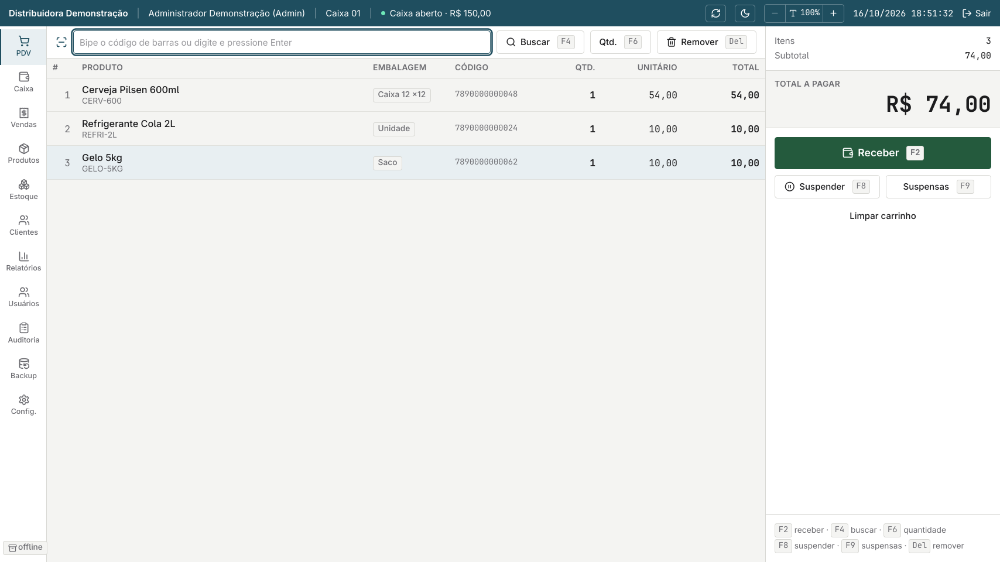

  
  <h1>Nomeris — downloads oficiais</h1>
  
<strong>Instaladores e atualizações do PDV desktop para distribuidoras de bebidas.</strong>

  

    
  

> **Este é o repositório de distribuição do Nomeris.** Aqui ficam o instalador Windows, os metadados de atualização e as notas de cada versão. O código-fonte e a documentação técnica ficam no repositório [`Henrique-Kenzo/Nomeris`](https://github.com/Henrique-Kenzo/Nomeris).

## Download

A versão disponível para avaliação é a **Nomeris 1.2.4**, distribuída como instalador completo para Windows x64:

- [Página da versão 1.2.4](https://github.com/Henrique-Kenzo/Nomeris-Releases/releases/tag/v1.2.4)
- [Baixar `Nomeris-Setup-1.2.4.exe`](https://github.com/Henrique-Kenzo/Nomeris-Releases/releases/download/v1.2.4/Nomeris-Setup-1.2.4.exe)
- [Ver todas as versões publicadas](https://github.com/Henrique-Kenzo/Nomeris-Releases/releases)

A versão 1.2.4 está marcada como **pré-lançamento** para homologação. Consulte as notas da versão antes de utilizá-la em uma operação real.

## O que acompanha o instalador

- aplicativo desktop Nomeris;
- MongoDB Community local e isolado;
- MongoDB Database Tools para backup e restauração;
- atualização integrada pelo próprio aplicativo;
- operação sem depender da internet durante o expediente, respeitando a política de licenciamento;
- banco de dados criado localmente na máquina do estabelecimento.

Nenhum banco de cliente, backup ou dado operacional é distribuído dentro do instalador.

## Antes de instalar ou atualizar

1. Feche os caixas e finalize as operações em andamento.
2. Faça um backup pelo próprio Nomeris.
3. Feche completamente o aplicativo.
4. Baixe o instalador apenas pela página **Releases** deste repositório.
5. Confira as notas e o SHA-256 publicados junto à versão.

Uma instalação nova começa sem dados operacionais. Para recuperar uma operação existente, utilize a restauração de backup suportada pelo aplicativo.

## Compatibilidade

| Item | Suporte |
| --- | --- |
| Sistema operacional | Windows 10 ou 11, 64 bits |
| Arquitetura | x64 |
| Banco de dados | MongoDB local incluído |
| Internet durante o expediente | não obrigatória |
| Emissão fiscal | não incluída |

## Aviso sobre assinatura digital

O instalador 1.2.4 não possui assinatura Authenticode de publicador. Por isso, o Windows pode exibir **“Publicador desconhecido”** ou um aviso do SmartScreen. Confira sempre se o arquivo foi baixado deste repositório e valide o SHA-256 informado na página da versão.

## Sobre o Nomeris

O Nomeris é um ponto de venda desktop voltado a distribuidoras de bebidas, com:

- leitura de código de barras e pagamentos mistos;
- catálogo com múltiplas embalagens;
- caixa, estoque e clientes;
- histórico, cancelamentos, devoluções e trocas;
- relatórios e visão gerencial;
- usuários, permissões e auditoria;
- backup e restauração locais.

Para arquitetura, desenvolvimento, testes e galeria completa, acesse o [repositório principal do Nomeris](https://github.com/Henrique-Kenzo/Nomeris).
